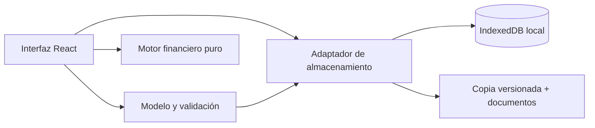

# Arquitectura y modelo de la V1

## Decisiones

La prioridad es un panel doméstico sencillo. React + TypeScript permiten reutilizar la interfaz en una futura PWA o contenedor de escritorio. Vite genera archivos estáticos que se sirven localmente; no existe un backend que reciba información financiera. IndexedDB conserva tanto registros estructurados como documentos Blob. Zod valida datos de formularios e importaciones.

La V1 separa datos reales, almacenamiento, reglas financieras e interfaz. No se presupone que los importes del resumen puedan reconstruirse perfectamente a partir de consumos: el total informado conserva autoridad.

## Estructura

- `src/model.ts`: entidades, esquemas, tipos y validación de integridad referencial.
- `src/finance.ts`: cálculos puros, proyecciones, prioridades y formato argentino.
- `src/storage.ts`: IndexedDB, adjuntos, exportación/importación y transacciones.
- `src/forms.ts`: definición de campos y ayudas para cada entidad.
- `src/ui.tsx`: formularios, diálogos accesibles, tablas, estados y gráficos reutilizables.
- `src/App.tsx`: navegación, composición de pantallas y coordinación de acciones.
- `src/demo.ts`: datos ficticios opcionales, independientes de la base vacía inicial.
- `src/style.css`: diseño adaptable, estilos de impresión y componentes visuales.
- `tests/finance.test.ts`: escenarios e invariantes del plan financiero.
- `tests/storage.test.ts`: integridad, persistencia y restauración con documentos.
- `tests/browser`: recorridos completos con Chromium.

## Entidades

| Entidad    | Campos principales y relaciones                                                                                                                                                                      |
| ---------- | ---------------------------------------------------------------------------------------------------------------------------------------------------------------------------------------------------- |
| Card       | id, banco, nombre, marca, últimos 4, días habituales de cierre/vencimiento, interés mensual y financiación mensual opcionales, observaciones                                                         |
| Statement  | id, cardId, período, cierre/vencimiento, saldo anterior, consumos informados, intereses, impuestos, otros cargos, pagos ya descontados por el banco, total real, mínimo, TEM opcional, observaciones |
| Expense    | id, statementId, fecha, descripción, importe, categoría, observación, purchaseId opcional                                                                                                            |
| Purchase   | id, cardId, descripción, período base, cuota actual, total de cuotas, valor de cuota                                                                                                                 |
| Payment    | id, statementId, fecha, importe, medio de pago                                                                                                                                                       |
| Service    | id, empresa, tipo personalizable, referencia opcional, observaciones                                                                                                                                 |
| Invoice    | id, serviceId, período, emisión/vencimiento, importe, pagado, fecha/medio de pago, observaciones                                                                                                     |
| Budget     | id, período, ingresos, otros gastos y dinero reservado para tarjetas                                                                                                                                 |
| Attachment | id, ownerId de resumen o factura, nombre, MIME y Blob del documento                                                                                                                                  |
| State      | versión del esquema, marca de demostración y colecciones de entidades                                                                                                                                |

Las fechas usan `YYYY-MM-DD`, los períodos `YYYY-MM`; los cálculos de días usan fechas sin horas para evitar cambios por horario de verano. Todos los importes son enteros no negativos en centavos, con límite por campo. Las tasas son números porcentuales mensuales o `null`: cero es una tasa conocida, `null` una tasa ausente. Los identificadores nuevos usan UUID.

Existe un resumen por tarjeta/período, una factura por servicio/período y un presupuesto por período. El mínimo no puede superar el total, la cuota actual no puede superar la cantidad total, y los pagos registrados no pueden superar el total. No se aceptan fechas imposibles ni referencias huérfanas.

## Motor de pagos

1. Seleccionar resúmenes del período con saldo pendiente.
2. Descontar pagos registrados tanto del saldo como del mínimo exigido; limitar el mínimo pendiente al saldo.
3. Distribuir mínimos por vencimiento, primero los más antiguos. Si no alcanza, mostrar el déficit y los mínimos descubiertos de cada tarjeta.
4. Asignar excedente según estrategia:
   - Recomendada: vencimientos dentro de tres días o anteriores; luego mayor TEM conocida; luego menor saldo.
   - Interés: mayor TEM conocida y vencimiento como desempate.
   - Bola de nieve: menor saldo.
5. No asignar más que el saldo ni más que el presupuesto. Mostrar excedente no asignado.

Las tasas desconocidas se señalan expresamente; no se consideran cero ni se inventan. Se usa primero la tasa del resumen y luego la de financiación de la tarjeta. No se usa el campo de interés general como sustituto silencioso de financiación. La comparación de interés estimado se omite si queda deuda con tasa desconocida.

La recomendación no garantiza el menor costo: desconoce las condiciones contractuales, interés por día, impuestos y cargos. No usa tasas bancarias externas. El historial alerta sobre aumentos entre los dos últimos resúmenes disponibles por tarjeta.

## Cuotas

La compra tiene un único identificador y un ancla: período de la cuota actual. La cantidad de meses transcurridos determina la cuota de cualquier período. El compromiso restante desde el ancla es `(total − actual) × valor`. La proyección mensual incluye cuotas posteriores al ancla hasta completar el total. Registrar un consumo con una compra nueva en cuotas crea la compra y su vínculo en el mismo cambio de estado validado; los consumos posteriores deben reutilizarla. No se crean resúmenes, consumos ni obligaciones reales a partir de proyecciones.

## Persistencia y recuperación

IndexedDB `mis-cuentas-local`, versión 1, tiene almacenes `state` y `attachments`. Las escrituras de estado y la eliminación de documentos huérfanos comparten una transacción. La importación reemplaza ambos almacenes en una transacción; primero se valida por completo la copia. Los errores de almacenamiento se muestran: no se anuncia éxito si no se confirma la transacción.

Las acciones leen el estado más reciente bajo Web Locks para serializar las escrituras entre pestañas del mismo origen. BroadcastChannel informa las modificaciones de registros a otras pestañas. Conviene trabajar en una única pestaña para no tener formularios con datos anteriores a una edición realizada en otra pestaña.

La copia tiene `format`, `version`, fecha de exportación, `state` y documentos base64. La versión permite agregar migraciones explícitas en futuras versiones; la app acepta copias de versiones 1 y 2, y genera versión 2. La base es local y no está cifrada. El navegador puede retirar almacenamiento, por eso la copia portable es esencial.

## Extensiones previstas

- PWA: manifiesto y service worker con recursos locales; probar actualizaciones antes de habilitar cachés.
- Escritorio: encapsular el mismo frontend y sustituir el adaptador de almacenamiento si corresponde; conservar el formato portable.
- OCR/extracción: agregar un adaptador de documentos que devuelva un borrador para revisión. No escribir importes automáticamente ni ejecutar servicios externos sin autorización explícita.
- Sincronización: nueva capa optativa con autenticación, cifrado, conflictos y consentimiento. La V1 no contiene ninguna ruta de sincronización.
- Migraciones: incrementar versiones y migrar una copia antes de alterar registros. Mantener las funciones presentes y sus pruebas.

## Logos locales por emisor

`src/banks.ts` normaliza nombres equivalentes y asigna un propietario estable `bank-logo:<emisor>`. `src/BankLogo.tsx` muestra el Blob local mediante una URL temporal, que se libera cuando deja de usarse. La carga admite PNG/JPG hasta 2 MB y reemplaza el logo anterior del emisor en una transacción; no requiere una migración de los registros financieros. Los logos se guardan en el almacén existente de adjuntos, se incluyen en las copias y se conservan mientras exista al menos una tarjeta de ese emisor. Sin imagen, se mantiene un ícono genérico y el nombre textual. No se realizan descargas de imágenes al usar la aplicación.

## Datos v2, importación y separación de monedas

La forma física de IndexedDB se conserva, con datos versionados en 2. `validateState` migra entradas de versión 1 cambiando únicamente el número de versión. Los campos USD son opcionales y los registros antiguos sin moneda son ARS; nunca se reemplazan tasas o importes de una moneda por los de otra. Las copias v2 son rechazadas por la app antigua, evitando perder USD por una importación silenciosa.

`src/importAccounts.ts` valida el paquete `mis-cuentas-extracted`, resuelve destinos y fusiona aditivamente. La interfaz `src/ImportAccounts.tsx` permite revisar la carga. Las claves estables distinguen cuentas, resúmenes y compras importados; se conservan los resúmenes existentes y todos sus pagos y documentos. Los consumos en cuotas crean su compra vinculada sin crear consumos futuros. Los identificadores parciales de cuenta o socio se distinguen de los últimos cuatro reales de tarjeta; un número desconocido no se inventa.

`requiredPayment` devuelve un importe o `null`. La modalidad de pago total confirmada permite exigir el saldo sin modificar el mínimo documental nulo. Los nuevos registros importados tienen `paymentsConfirmed=false`; el motor devuelve un plan bloqueado sin asignaciones si queda alguna obligación o pago sin revisar en esa moneda. Los importes de pagos anteriores descontados por el banco se conservan como conciliación, no se convierten en nuevos registros Payment.

## Prompt de extracción para el ChatGPT del usuario

`src/statementPrompt.ts` genera las instrucciones y un ejemplo ficticio válido del contrato `mis-cuentas-extracted`. El registro dinámico solo contiene identidad parcial de tarjetas y referencias de compras en cuotas, sin saldos, pagos ni notas privadas. `src/StatementPrompt.tsx` permite elegir el contexto, copiarlo y consultar el texto completo. No existe integración automática con una API de IA.

El lector de texto acepta JSON estándar y un bloque Markdown JSON completo, además del código compacto previo. El contrato opcional de respuesta `mis-cuentas-extraction-error` permite comunicar datos ilegibles sin inventar una cuenta importable. Los errores de estructura señalan rutas de campos para pedir una corrección. Al vincular una tarjeta manual por primera vez se guarda una clave de importación estable; las compras usan la clave canónica de la tarjeta, aunque otra respuesta externa utilice un alias. Las cuotas de compras existentes se verifican contra el período y total conocidos antes de enlazar un nuevo consumo. Un conflicto de identidad en una clave automática exige revisión.
